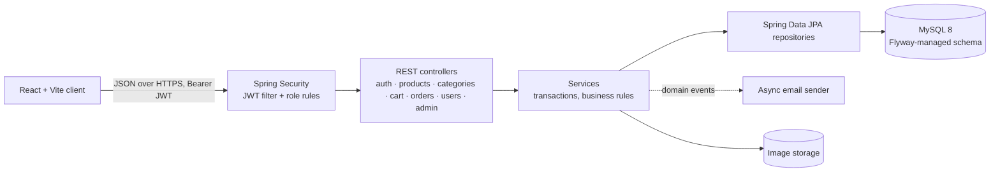

# 🌾 AgriConnect: Farmer-to-Customer Marketplace

[](https://github.com/AbdulKaleemShaik/AgriConnect/actions/workflows/ci.yml)


AgriConnect lets farmers sell produce directly to customers without middlemen. Farmers list products, customers browse, add to cart and check out, and farmers fulfil orders through a status workflow. Admins manage users, categories and all orders.

The backend is a **Spring Boot 3 REST API** (a layered modular monolith) secured with **Spring Security + JWT**, backed by **MySQL** with **Flyway** migrations. The frontend is a **React (Vite)** app.

---

## ✨ Highlights

| Area | What it does |
|---|---|
| **Overselling protection** | Checkout runs in one transaction that first locks every product in the cart with `SELECT … FOR UPDATE`, always in id order, so concurrent checkouts queue instead of deadlocking. Products also carry an `@Version` column (optimistic locking) as a second safeguard, and lock conflicts map to `409`. When several customers buy the last unit at the same moment, exactly one succeeds and the rest get `409 Conflict`; stock never goes negative. Covered by a concurrent integration test that CI also runs on real MySQL, where it caught an InnoDB deadlock (foreign-key shared lock vs. stock update) that H2 could not reproduce. |
| **Security** | Stateless JWT auth, role-based access (`CUSTOMER`, `FARMER`, `ADMIN`) enforced at URL level and with `@PreAuthorize`, BCrypt passwords, **account lockout** after 5 failed logins (15 min), and password reset via a **hashed, expiring OTP** with an attempt limit. |
| **Clean API design** | Request/response DTOs with Jakarta Bean Validation, a global `@RestControllerAdvice` returning one consistent error format, and paginated product search with JPA Specifications (category + text query). |
| **Database migrations** | Schema owned by **Flyway** (`db/migration`); Hibernate runs with `ddl-auto=validate`, so drift between entities and the schema fails fast. CI applies the migrations to a real MySQL 8 and runs the whole test suite against it. |
| **Async email** | Order and password-reset emails are published as events and sent `@Async` after the transaction commits, so a slow mail server never blocks a checkout. |
| **File uploads** | Product and profile images with content-type allow-list (JPEG/PNG/WEBP/GIF). |
| **Ops-ready** | Multi-stage Dockerfile (non-root, healthcheck), Docker Compose stack, Spring Boot Actuator health endpoint, OpenAPI/Swagger UI, all config from environment variables (no committed secrets). |

---

## 🏗️ Architecture



Packages are organised **by feature** (`auth`, `catalog`, `cart`, `order`, `user`, `admin`, `security`, `notification`, `common`), each with its own controller, service, repository and DTOs.

---

## 🛠️ Tech Stack

- **Backend:** Java 21, Spring Boot 3.5, Spring Web, Spring Security, Spring Data JPA (Hibernate), Bean Validation, JJWT, Spring Mail, Actuator
- **Database:** MySQL 8, Flyway (H2 in MySQL mode for fast tests)
- **API docs:** springdoc-openapi (Swagger UI)
- **Testing:** JUnit 5, Mockito, Spring Boot Test, MockMvc, Spring Security Test
- **DevOps:** Docker, Docker Compose, GitHub Actions
- **Frontend:** React, Vite, Axios

---

## 📡 API Overview

Interactive docs: **`http://localhost:8080/swagger-ui.html`** (OpenAPI JSON at `/v3/api-docs`).

| Method & path | Access | Purpose |
|---|---|---|
| `POST /api/auth/register/customer` · `/register/farmer` | Public | Register (multipart, optional profile image) |
| `POST /api/auth/login` | Public | Get a JWT |
| `POST /api/auth/forgot-password` · `/reset-password` | Public | OTP-based password reset |
| `GET /api/products?category=&q=&page=&size=` | Public | Paginated product search |
| `GET /api/products/{id}` | Public | Product details |
| `GET /api/products/mine` | Farmer | Farmer's own listings |
| `POST /api/products` · `PUT /api/products/{id}` | Farmer | Create / update a listing (multipart with image) |
| `DELETE /api/products/{id}` | Farmer, Admin | Soft-delete a listing (order history is kept) |
| `GET /api/categories` · `/all` | Public · Admin | Categories; admins manage them with `POST/PUT/DELETE` |
| `GET /api/cart` · `POST /api/cart/items` · `PUT/DELETE /api/cart/items/{productId}` · `DELETE /api/cart` | Customer | Cart management |
| `POST /api/orders` | Customer | Check out the cart (atomic, stock-safe) |
| `GET /api/orders/mine` · `POST /api/orders/{id}/cancel` | Customer | Order history; cancel before shipping (restores stock) |
| `GET /api/orders/farmer` · `PATCH /api/orders/{id}/status` | Farmer, Admin | Fulfil orders through the status workflow |
| `GET /api/orders/{id}` · `/number/{orderNumber}` | Owner | Track an order |
| `GET/PUT /api/users/me` · `PUT /api/users/me/password` | Signed in | Profile and password |
| `GET /api/admin/users` · `PATCH /api/admin/users/{id}/status` · `GET /api/admin/orders` | Admin | User and order administration |

All errors share one shape: `{ timestamp, status, error, message, path, fieldErrors[] }`.

---

## 🚀 Running Locally

### Option 1: Docker Compose (MySQL + API)

```bash
cp .env.example .env          # set DB_PASSWORD, MYSQL_ROOT_PASSWORD, JWT_SECRET
docker compose up --build
# API: http://localhost:8080  ·  Swagger: http://localhost:8080/swagger-ui.html
```

### Option 2: Without MySQL (in-memory H2)

```bash
cd backend
./mvnw spring-boot:run -Dspring-boot.run.profiles=h2
```

### Frontend

```bash
cd frontend
cp .env.example .env          # VITE_API_URL=http://localhost:8080
npm install
npm run dev                   # http://localhost:5173
```

> The React client talks to the `/api/*` endpoints above through a single Axios instance (`frontend/src/Service/AxiosInstant.js`) whose base URL comes from `VITE_API_URL` (default `http://localhost:8080`); it attaches the JWT and resolves image paths such as `/images/products/...` against that base URL.

### Environment variables (backend)

| Variable | Default | Notes |
|---|---|---|
| `DB_URL` / `DB_USERNAME` / `DB_PASSWORD` | local MySQL | JDBC connection |
| `JWT_SECRET` | random per start | 32+ characters; set it in any shared environment |
| `JWT_EXPIRATION` | `PT24H` | ISO-8601 duration |
| `CORS_ALLOWED_ORIGINS` | `http://localhost:5173` | Comma-separated |
| `ADMIN_EMAIL` / `ADMIN_PASSWORD` | empty | Bootstraps an admin account on first start |
| `MAIL_ENABLED`, `MAIL_HOST`, `MAIL_PORT`, `MAIL_USERNAME`, `MAIL_PASSWORD`, `MAIL_FROM` | disabled | SMTP for order and reset emails |
| `UPLOAD_DIR` | `uploads` | Image storage path |
| `JPA_DDL_AUTO` | `validate` | Schema is managed by Flyway |

---

## 🧪 Testing

```bash
cd backend
./mvnw test
```

**70 tests** across unit tests (services with Mockito, JWT service) and full-stack integration tests (MockMvc through the real security filter chain):

| Suite | Covers |
|---|---|
| `AuthServiceTest`, `AuthIntegrationTest` | Registration, login, lockout after repeated failures, OTP password reset |
| `JwtServiceTest` | Token issue, expiry, tampering |
| `ProductServiceTest`, `ProductControllerWebMvcTest` | Listing CRUD, ownership rules, validation, search |
| `CartServiceTest`, `OrderServiceTest` | Cart rules, checkout, cancellation, status transitions |
| `MarketplaceFlowIntegrationTest` | End-to-end: farmer lists → customer buys → farmer fulfils |
| `ConcurrentCheckoutIntegrationTest` | 5 simultaneous buyers for the last unit → exactly 1 order, 4 × `409`, stock = 0 |
| `AccessControlIntegrationTest` | 401/403 rules for every role |

CI runs the suite twice: on H2 for speed, and on **MySQL 8 with Flyway + schema validation** to prove the migrations match the entities.

---

## 📁 Project Structure

```
backend/
  src/main/java/com/agriconnect/
    auth/ catalog/ cart/ order/ user/ admin/     # feature packages
    security/                                     # JWT filter, security config
    notification/                                 # async email events
    common/                                       # errors, paging, file storage
    config/                                       # app properties, OpenAPI, async
  src/main/resources/db/migration/                # Flyway migrations
  Dockerfile
frontend/                                         # React (Vite) client
docker-compose.yml
.github/workflows/ci.yml
```
